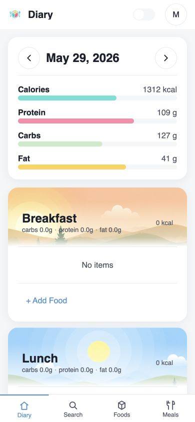
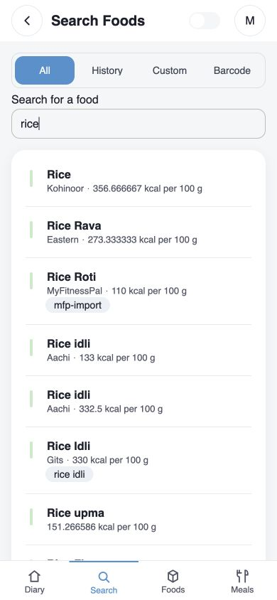
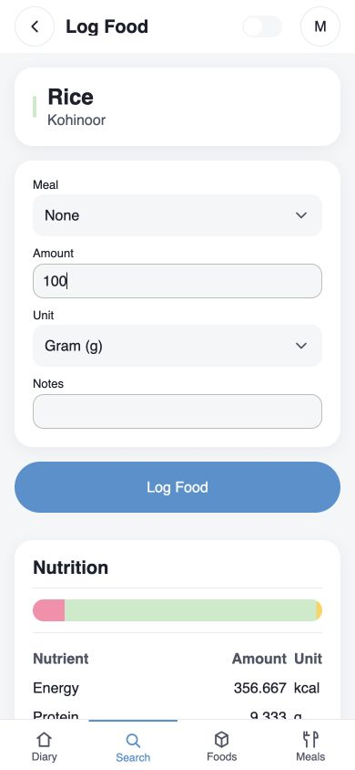
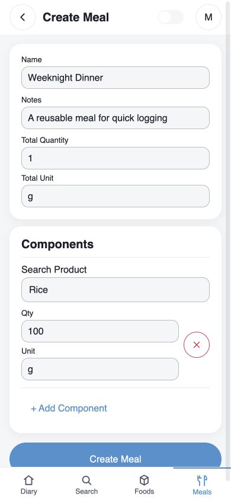
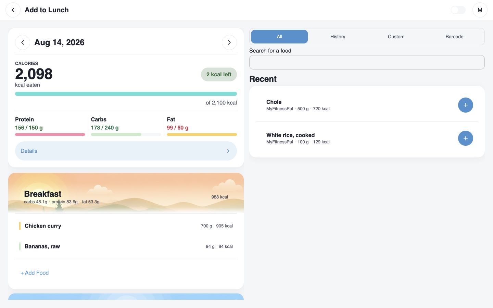

# CalCo

CalCo is a self-hosted food and nutrition tracker for a small homelab/household setup.

The app is intentionally simple: search or create foods, log what was eaten, snapshot nutrients at log time, and review the selected day. It also supports reusable meals/recipes and CLI-driven catalog imports from external food datasets.

## Mobile Showcase

| Daily diary and macro progress | Catalog search | Quantity-aware nutrition and logging | Reusable meal builder |
| :---: | :---: | :---: | :---: |
|  |  |  |  |

## Desktop Showcase

The diary and food search stay visible together on wider screens.

  

## Stack

- Backend: Rust, axum, sqlx, PostgreSQL
- Frontend: Elm 0.19.2, elm-ui
- Database: PostgreSQL via Docker Compose
- Tooling: Nix flake, just, Python import scripts

## Current Scope

Implemented:

- Username/password auth with bootstrap admin and admin user management
- Food catalog search/detail, camera and manual barcode lookup, custom food CRUD
- Food logs with nutrient snapshots, daily summaries, recent-item defaults, and
  latest-slot repeat
- Meal/recipe CRUD and meal logging
- Responsive web frontend with configurable diary meal slots
- CLI import pipeline for USDA SR Legacy, Open Food Facts India, IFCT 2017, and INDB 2024 data

Not the goal right now:

- Analytics dashboards, trends, or charts
- Browser UI for import jobs
- Offline/service-worker behavior
- Native mobile app

## Documentation

- [Features](docs/features.md): product checklist and current scope
- [Architecture](docs/architecture.md): system structure and DDD decisions
- [Backend](docs/backend.md): backend domains, APIs, persistence, and invariants
- [Frontend](docs/frontend.md): frontend routes, UI structure, and design rules
- [Button System](docs/buttons.md): unified button API and documented exceptions
- [Local Development](docs/local-development.md): dev shell, services, env vars, tests, i18n
- [Deployment](docs/deployment.md): NixOS module, reverse proxy, and production setup
- [Imports](docs/imports.md): catalog CLI import pipeline and source merging
- [Personal Data Import](docs/personal-data-import.md): MyFitnessPal export workflow
- [Testing](docs/testing.md): automated test layout and commands
- [QA Runbook](docs/qa-runbook.md): end-to-end browser release checks

Setup details live in the docs above, not in this README. Start with
[Local Development](docs/local-development.md) for a working dev environment, or
[Deployment](docs/deployment.md) to run CalCo on a server.
